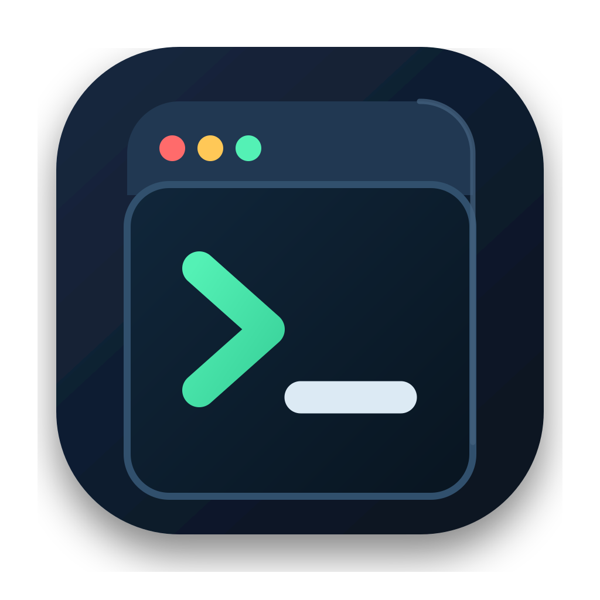

# Terminal Master

Terminal Master is a Flutter desktop application for building validated terminal
commands from reusable YAML definitions. It keeps command options discoverable,
checks conditional input requirements, and asks for explicit confirmation before
returning commands marked as risky.

Commands can run in a persistent, resizable `xterm` side panel backed by a
native pseudo terminal (`flutter_pty`). The panel stays active while navigating
between YAML definitions, and the configured external terminal remains
available as a fallback. It can be maximized inside the app and provides font
zoom, highlighted scrollback search, a visible scrollbar, and a shortcut back
to the latest output.

Generated commands are collected in the panel's editable command field without
an execution confirmation. This
allows commands from multiple YAML definitions to be reviewed or combined
before explicitly sending them to the shared shell session.

Terminal keyboard shortcuts use `Cmd` on macOS and `Ctrl` on Windows/Linux:

- `Cmd/Ctrl+F`: search the scrollback
- `Cmd/Ctrl++`, `Cmd/Ctrl+-`, `Cmd/Ctrl+0`: adjust or reset the font size
- `F11`: maximize or restore the terminal panel

The PTY advertises `xterm-256color` and `COLORTERM=truecolor`. The renderer
supports ANSI styles, 16/256/24-bit colors, wide Unicode characters, and system
monospace/emoji font fallbacks. Alternate-screen and mouse-reporting modes are
shown in the terminal status bar. Interactive terminal applications receive
click, wheel, drag, and pointer-move events while mouse reporting is active;
normal scrollback behavior remains available when an application does not
request wheel events.



## Development

Terminal Master requires the Flutter stable channel.

```sh
flutter pub get
flutter analyze
flutter test
flutter run -d macos
```

Replace `macos` with `windows` or `linux` when developing on those platforms.

The native PTY smoke test can be run on a desktop target with:

```sh
flutter test integration_test/terminal_pty_test.dart -d macos
```

## Command Definitions

YAML definitions are stored in `data/`. The application copies its bundled
definitions to the platform application-support directory, where they can be
extended or replaced without rebuilding the application.

## Desktop Releases

The release workflow creates these unsigned artifacts:

- macOS: DMG and ZIP
- Windows: Inno Setup installer and ZIP
- Linux: DEB, AppImage, and tarball
- Linux package manifests: Arch `PKGBUILD` and Nix `flake.nix`

Push a tag matching the semantic version in `pubspec.yaml`, for example `v1.0.0`,
or run the Release workflow manually. The workflow creates a draft GitHub release
so its artifacts can be checked before publication.
