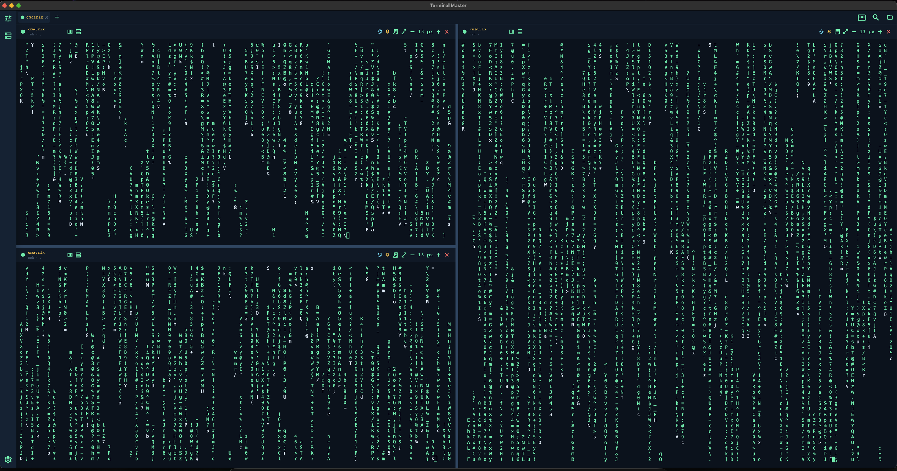

# Terminal Master

**Terminal Master is a cross-platform desktop terminal and command-building workspace.** Build validated commands from reusable YAML definitions, review them before execution, and run them in persistent terminals with tabs and split panes. It also provides managed SSH connections with credentials stored in the operating system's secure store.



*Three interactive terminal sessions in a resizable split layout.*

## What it does

- **Build commands from YAML:** searchable forms support options, dependencies, and conditional fields. Definitions can be edited in the app.
- **Review before running:** generated commands are staged in an editable field; elevated or destructive commands require explicit confirmation.
- **Work across persistent terminals:** use independent tabs and resizable split panes, search scrollback, and keep sessions running while navigating the app.
- **Manage SSH connections:** verify server host keys, store passwords and key passphrases in the OS credential store, and create encrypted connection backups.
- **Track and restore work:** inspect command results and save terminal-tab layouts for later sessions.

The integrated terminal is backed by native pseudo-terminals and supports interactive terminal applications, ANSI colors, mouse reporting, and visible hyperlinks. Terminal Master runs on macOS, Windows, and Linux.

## Keyboard shortcuts

Shortcuts use `Cmd` on macOS and `Ctrl` on Windows/Linux:

- `Cmd/Ctrl+F`: search terminal scrollback
- `Cmd/Ctrl+B`: open or close the Command Builder
- `Cmd/Ctrl++`, `Cmd/Ctrl+-`, `Cmd/Ctrl+0`: zoom in, zoom out, or reset the terminal font size

## Integrated Shell Profiles

Without configuration, Terminal Master offers the platform shell and installed
Bash, Zsh, or Fish executables it can detect. Custom local shells, SSH sessions,
containers, and other interactive programs can be defined in `settings.yaml`:

```yaml
integrated_terminal:
  default_profile: local-zsh
  profiles:
    - id: local-zsh
      name: Local Zsh
      executable: /bin/zsh
      arguments: [-l]
      working_directory: ~/projects
      dialect: posix
    - id: production-ssh
      name: Production SSH
      executable: /usr/bin/ssh
      arguments: [example.com]
      environment:
        LANG: en_US.UTF-8
      dialect: posix
    - id: powershell
      name: PowerShell 7
      executable: /usr/bin/pwsh
      arguments: [-NoLogo]
      dialect: powershell
```

Profile IDs must be unique. Supported command dialects are `posix`,
`windows_cmd`, and `powershell`; the selected dialect controls command quoting,
line endings, and Command Block exit-code tracking. Windows PowerShell is the
default Windows profile when PowerShell 7 is unavailable; installed PowerShell
7 executables are detected across supported desktop platforms.
Terminal Master variables such as `TERM=xterm-256color` and
`COLORTERM=truecolor` remain authoritative.

The default shell can be changed from the settings button at the bottom of the
tool rail. The selection updates `integrated_terminal.default_profile` in
`settings.yaml`. The `+` action beside the tabs then opens the selected shell
immediately without showing a profile menu; existing tabs are not changed.
The same settings page can select a default YAML directory for the Command
Builder. The choice is stored as `yaml_directory` in `settings.yaml` and takes
effect immediately.

## SSH Connections

The SSH connections page stores reusable server profiles with a display name,
host, port, username, and either password or private-key authentication.
Passwords and optional private-key passphrases are kept separately in the
operating system's secure credential store: Keychain on macOS, Credential
Manager on Windows, and Secret Service on Linux. Private keys remain in their
selected files. Secrets are never written to YAML, profile metadata, terminal
snapshots, or application logs.

Private-key profiles are currently available on desktop platforms. Mobile file
pickers expose temporary cache paths rather than durable references, so Terminal
Master deliberately disables private-key selection on Android and iOS.

Connections use an interactive `xterm-256color` remote PTY. The first connection
shows the server's SHA-256 host-key fingerprint and requires explicit trust for
one connection or permanent storage. A changed trusted host key is always
blocked. Profiles can be added, edited, tested, connected in a new terminal tab,
and deleted together with their stored credential. Supported private-key input
includes OpenSSH RSA, Ed25519, and ECDSA keys plus legacy RSA keys accepted by
`dartssh2`; unsupported PKCS#8 keys must first be converted with `ssh-keygen`.
Linux systems need a running
Secret Service provider such as GNOME Keyring or KWallet; without one, secure
password storage reports an error instead of falling back to plaintext.

Complete connection lists, including passwords, key passphrases, private-key
paths, and pinned host keys, can be exported as `.tmsshbackup` files. Private
key contents are deliberately excluded. Backup passwords must contain at least 12
characters. Argon2id derives a 256-bit key with a 64 MiB memory cost, and
AES-256-GCM encrypts and authenticates the complete payload; no profile or
password data is written outside the ciphertext. Import verifies the format and
authentication tag before showing a preview. Endpoint conflicts default to
skip and can explicitly be replaced or imported as a copy. Host-key differences
are highlighted, and a compare-and-swap update prevents the import from
overwriting profiles changed while the preview was open. Backup passwords cannot
be recovered by Terminal Master.

## SSH Command Generator

The bundled `ssh.yaml` provides an SSH command form with a required host
dropdown. Its initial entries are `localhost` and reserved staging/production
example domains. Replace these entries in the installed `ssh.yaml` with real
hostnames, IP addresses, or aliases from `~/.ssh/config`. The form also supports
username, port, identity file, ProxyJump host, IPv4/IPv6, compression, agent and
X11 forwarding, batch mode, host-key policy, verbosity, and an optional remote
command.

Every YAML `options` field uses the same searchable selection dialog. It filters
case-insensitively across both the configured value and description, supports
arrow-key/Enter/Escape navigation, and keeps `Nicht verwenden` available for
optional fields. `Eintrag hinzufügen` stores a new value and description
directly in the current YAML options list, creates a `.bak` backup, validates the
updated file, and selects the new entry immediately. Concurrent external changes
and duplicate values are rejected instead of being overwritten. Individual
entries can be permanently removed with the delete action after confirmation;
the last remaining option and entries referenced by defaults or conditions are
protected from deletion.

Batch command views also support persistent editing. The add action stores a
title, optional description, and command in the current batch YAML file. Rows
always show their title and play action without a separate expansion arrow.
Clicking the row reveals its description plus copy and delete actions. Play
stages that command in the editable field of the internal terminal without
executing it immediately; delete requires confirmation. Mutations validate the
updated YAML and preserve the previous source in a `.bak` file.

## Command Blocks

Commands sent through a tab's Terminal Master input field are tracked as
Command Blocks. Each block records its command, start time, duration, exit code,
success/failure/interruption state, and up to 500,000 characters of plain-text
output. Tracking markers are removed from the visible terminal output. Blocks
can copy their command or output and export a Markdown report through the
history button in the terminal status bar. Commands typed directly into the
terminal remain untracked and behave like a normal shell session.

## Saved Terminal Tabs

The save action in a tab's right-click menu saves or updates a named tab
snapshot. Snapshots preserve the one-to-four-pane layout, shell profile and
last working directory of every pane, the focused pane, pending command drafts,
and the latest 20 completed Command Block commands per pane. Terminal output
and commands typed directly into the PTY are not persisted.

The folder action opens a snapshot as a new tab with fresh PTY processes. Saved
commands are listed separately in Command Blocks and can be copied, loaded into
the editable command field, executed individually, or executed sequentially for
their pane. Standard commands run from the explicit play action; elevated and
destructive commands require the existing risk acknowledgement. Opening does
not execute commands by default. An optional switch in the open dialog previews
all saved commands and, after explicit confirmation, replays them sequentially
per pane while separate panes may run in parallel. Snapshots are stored in
`saved_terminal_tabs.json` in Terminal Master's application-support directory.


## Development

Terminal Master requires the Flutter stable channel.

```sh
flutter pub get
flutter analyze
flutter test
flutter run -d macos
```

Replace `macos` with `windows` or `linux` when developing on those platforms.

The native PTY smoke test can be run on a desktop target with:

```sh
flutter test integration_test/terminal_pty_test.dart -d macos
```

## Command Definitions

YAML definitions are stored in `data/`. The application copies its bundled
definitions to the platform application-support directory, where they can be
extended or replaced without rebuilding the application. A different directory
can be selected in the application settings; changing it does not move or copy
existing definitions.

### Multilingual Definitions

`schema_version: 2` adds language-suffixed fields. Any user-facing field may be
written as `<field>.<languageCode>` next to its base form:

```yaml
schema_version: 2
command: git_status
description: Shows the working tree status
description.de: Zeigt den Arbeitsverzeichnis-Status an
parameters:
  - name: short
    type: boolean
    flag: "--short"
    description: Compact output
    description.de: Kompakte Ausgabe
```

The loader reads `<field>.<active language>` when the file provides it and
otherwise falls back to the unsuffixed field, so the base form acts as the
default for every language that has no translation. `title`, `description`,
`display_name`, `help_text`, `label`, `note` and `example` support this,
including the `description` of individual `options` entries. Translating a
field is always optional — a file may translate some fields and leave the rest
to the base language.

`schema_version: 1` files keep working unchanged: without suffixed fields the
resolution is identical to the previous behaviour.

## Localization

The interface ships in English and German. The language follows the operating
system by default and can be fixed in the application settings, which persists
it as `language:` in `settings.yaml` (`system`, `en` or `de`).

Interface strings live in ARB files under `lib/l10n/`. `app_en.arb` is the
template and the fallback for untranslated keys; `app_de.arb` holds the German
translation. `AppLocalizations` is generated from them by `gen-l10n` (configured
in `l10n.yaml`) and the generated sources are committed, so a fresh checkout
analyzes and builds without a codegen step. After editing an ARB file:

```sh
flutter gen-l10n
```

`test/l10n_completeness_test.dart` fails if the translations and the template
drift apart — a missing key, a stray key, mismatched placeholders, or an empty
message.

Code below `lib/pages/` and `lib/widgets/` has no access to the locale, so it
never formats user-facing text. Services, stores, loaders and models raise typed
errors carrying a reason code plus the offending value (for example
`ConfigErrorReason.mustBeList`, `SshBackupFailure.wrongPasswordOrTampered`), and
`lib/l10n/error_presenter.dart` turns those codes into text in the active
language at the UI boundary. The `message` getter on each of those exceptions
stays English on purpose: it feeds logs and `toString()`, not the interface.

## Desktop Releases

The release workflow creates these unsigned artifacts:

- macOS: DMG and ZIP
- Windows: Inno Setup installer and ZIP
- Linux: DEB, AppImage, and tarball
- Linux package manifests: Arch `PKGBUILD` and a native Nix `flake.nix`

The Nix package installs and patches the release tarball directly instead of
running the AppImage through an FHS sandbox. This keeps host facilities such as
NixOS's `/run/wrappers/bin/sudo` available to the integrated terminal.

Push a tag matching the semantic version in `pubspec.yaml`, for example `v1.0.0`,
or run the Release workflow manually. The workflow creates a draft GitHub release
so its artifacts can be checked before publication.

## License

Terminal Master is licensed under the Apache License 2.0. See [LICENSE](LICENSE)
for the license text. Third-party dependencies remain under their respective
licenses.
